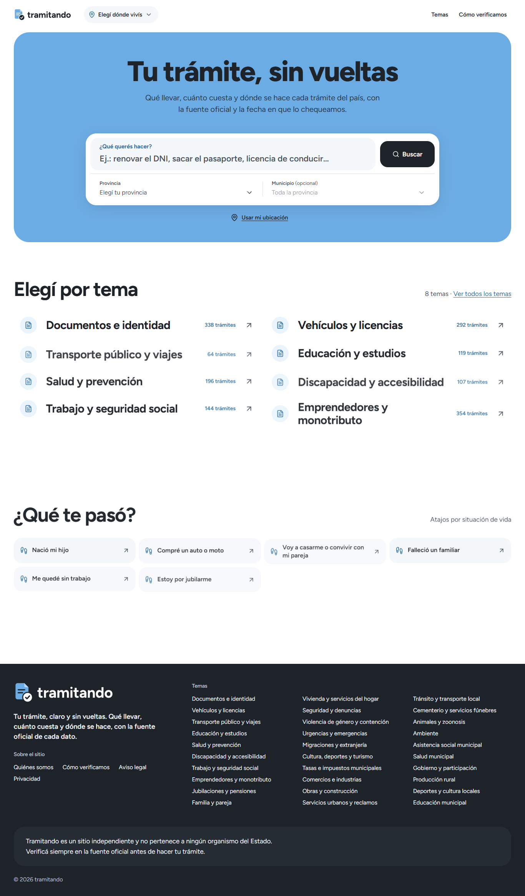
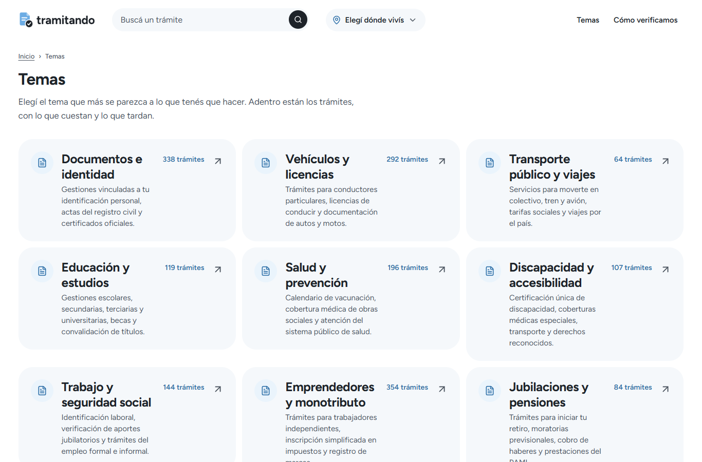
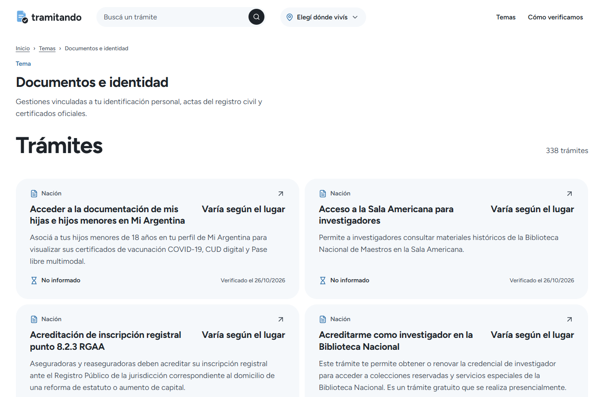
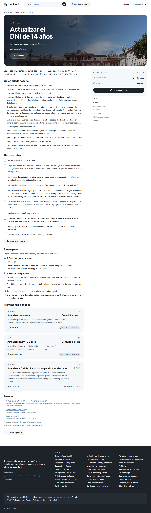
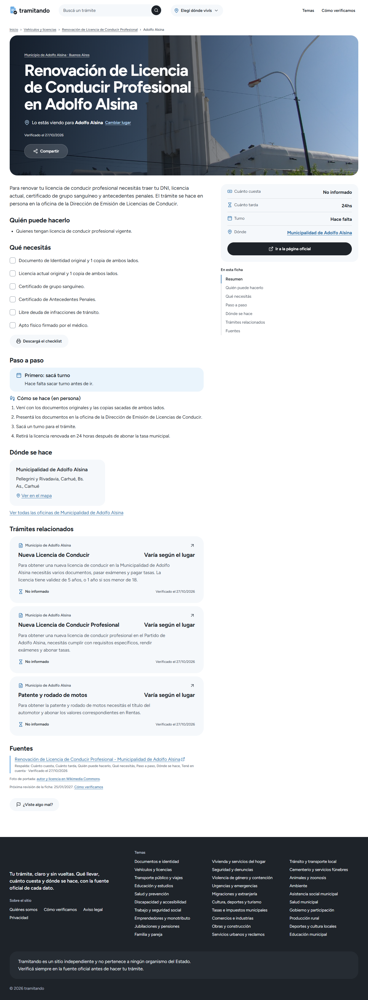

<p align="center">
  
</p>

<h3 align="center">Tu trámite, claro y sin vueltas.</h3>

<p align="center">
  Guía abierta y gratuita de trámites públicos de la Argentina (Nación, provincias y municipios).<br />
  Qué necesitás, cuánto cuesta, cuánto tarda y dónde se hace cada trámite, en lenguaje claro y con fuente oficial.
</p>

> **Proyecto liberado a la comunidad (Open Source):**  
> Arranqué este proyecto hace **1 o 2 semanas**. Todavía está **muy verde** y falta bastante por analizar y depurar para subir todos los documentos del país. **Por falta de tiempo lo libero entero para que cualquiera que quiera pueda retomarlo y terminarlo**, con la idea de que siga siendo **100 % abierto y gratuito**.

---

## La idea

En la Argentina, la información para hacer un trámite público está repartida entre cientos de sitios de Nación, provincias y municipios, muchas veces desactualizada o escrita en lenguaje burocrático. Eso hace que la gente pierda tiempo o vaya dos veces a la misma oficina porque le faltó un papel.

**Tramitando** busca juntar todo en un solo lugar:

1. **Qué querés hacer y dónde vivís:** elegís el trámite y tu ubicación (provincia y municipio) para ver los requisitos que te corresponden.
2. **Fichas claras y siempre iguales:** cuánto cuesta, cuánto tarda, si requiere turno, un checklist interactivo (e imprimible) con lo que tenés que llevar, el paso a paso (online y presencial), oficinas con mapa y el link directo a la fuente oficial.
3. **Solo fuentes oficiales:** cada dato queda atado a su enlace oficial (`.gob.ar`, `.gov.ar` o sitios municipales verificados) y a la fecha en que se chequeó.

---

## Capturas de pantalla

### 1. Portada (`¿Qué querés hacer?`)
Buscador principal enfocado en qué trámite necesitás hacer y en qué provincia/municipio, seguido de los accesos por tema y por situación de vida.



### 2. Temas (`/temas`)
Índice general de categorías con la cantidad de trámites publicados en cada una.



### 3. Interior de un tema (`/temas/documentos-e-identidad`)
Al entrar a un tema se listan directamente todos sus trámites con resumen, costo, plazo y estado de verificación.



### 4. Ficha completa de un trámite (`/tramites/actualizar-dni-14-anos`)
Vista completa de un trámite: resumen de costo, plazo y turno, quién puede hacerlo, checklist interactivo de requisitos, paso a paso, trámites relacionados y fuentes oficiales.



### 5. Ficha municipal (`/tramites/renovacion-de-licencia-de-conducir-profesional/buenos-aires/adolfo-alsina`)
Ejemplo de trámite municipal con dirección de oficina local y fuente del municipio.



---

## Estado actual y qué falta

El desarrollo lleva apenas **1 a 2 semanas**, por lo que está en una etapa inicial:

- **Lo que ya está hecho:** el frontend en Astro (`apps/web`), la API en Hono sobre Cloudflare Workers + D1 con buscador FTS5 (`apps/api`), el contrato de datos en Zod (`packages/shared`), el manual de marca (`brand/manual`) y el pipeline de relevamiento (`research`) con unas **3.400 fichas iniciales** ya estructuradas sobre más de **870 jurisdicciones** relevadas.
- **Lo que falta hacer:** quedan más de **21.500 páginas y documentos en cola** pendientes de analizar, limpiar y verificar antes de publicarlos, relevar municipios faltantes, extraer datos que están adentro de PDFs/ordenanzas y terminar de curar las fichas en borrador.

---

## Principales dificultades encontradas

- **Desorden en los sitios oficiales:** mientras Nación tiene páginas ordenadas, en los más de 2.000 municipios hay sitios sin dominio `.gob.ar`, portales que mezclan noticias con trámites o costos metidos adentro de PDFs.
- **Volumen de documentos:** son decenas de miles de páginas para descargar, filtrar (descartando notas de prensa) y estructurar sin que se filtren datos incompletos ni enlaces rotos.
- **Portales bloqueados o en JavaScript:** varios sitios provinciales y municipales bloquean peticiones automáticas o requieren renderizar JavaScript con un navegador headless para poder leer los requisitos.

---

## Estructura del proyecto

| Carpeta | Qué es |
| :--- | :--- |
| [`apps/web`](apps/web) | Web pública en **Astro (SSR)** sobre Cloudflare Workers. |
| [`apps/api`](apps/api) | API en **Hono** sobre Cloudflare Workers con **D1** (SQLite + FTS5) y **R2**. |
| [`packages/shared`](packages/shared) | Esquemas Zod y tipos compartidos entre la web, la API y el pipeline. |
| [`research`](research) | Scripts y pipeline para relevar portales oficiales y armar los borradores de fichas. |
| [`brand/manual`](brand/manual) | Manual de marca, paleta, tipografía y logos en SVG. |

---

## Cómo correrlo en local

Requisitos: **Node.js 22+**.

```bash
npm install
cp apps/api/.dev.vars.ejemplo apps/api/.dev.vars
cp apps/web/.dev.vars.ejemplo apps/web/.dev.vars
npm run db:migrar -w @tramitando/api
```

En una terminal, levantá la API (`:8787`) y cargá los datos de prueba:

```bash
npm run dev -w @tramitando/api
npm run seed:temas -w @tramitando/api
npm run seed:ejemplo -w @tramitando/api
```

En otra terminal, levantá la web (`:4321`):

```bash
npm run dev -w @tramitando/web
```
